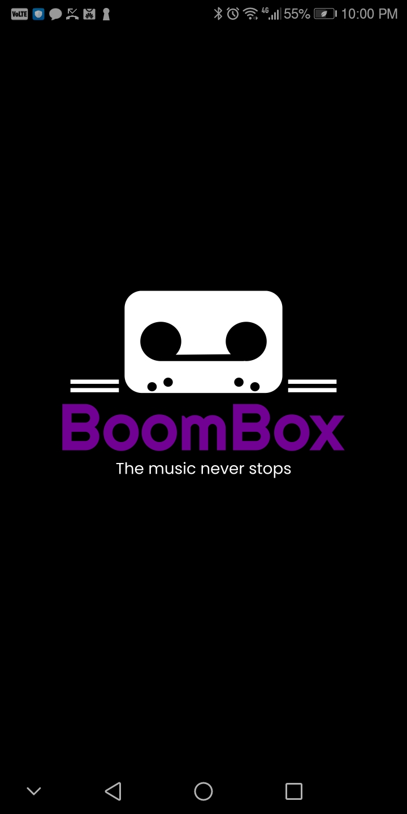
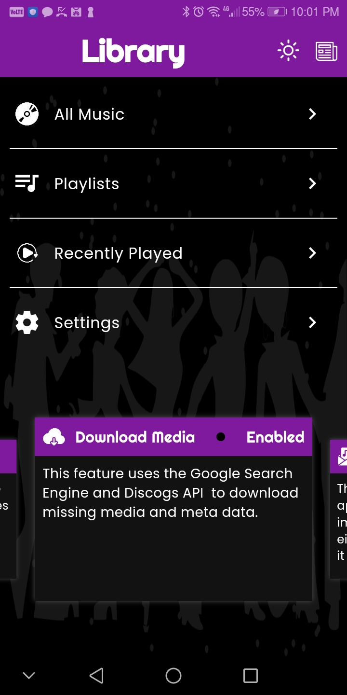
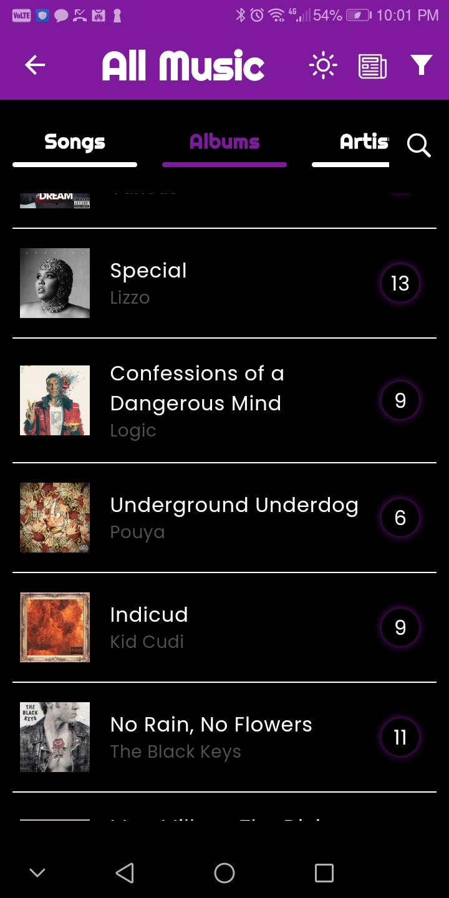
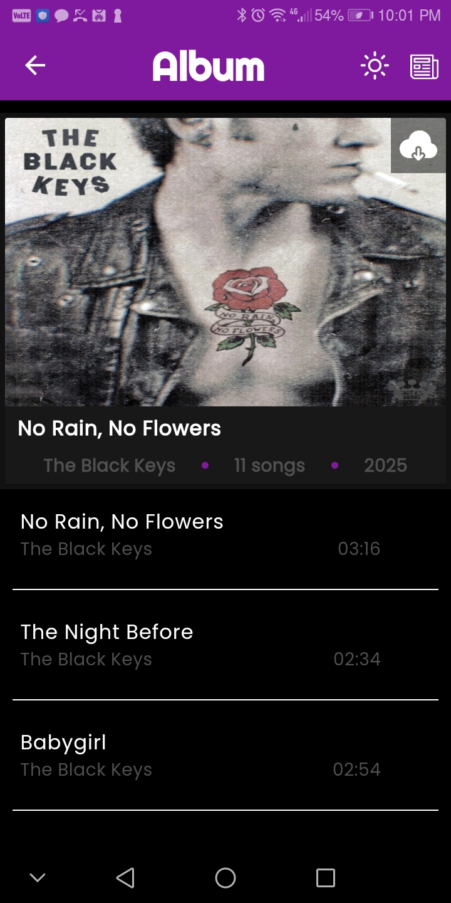
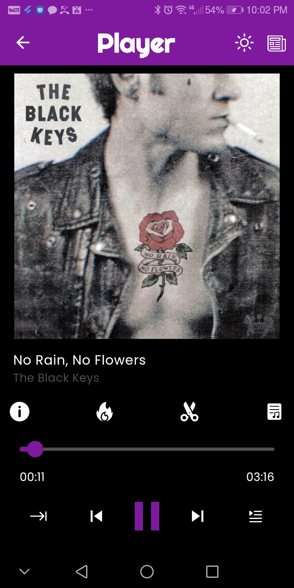
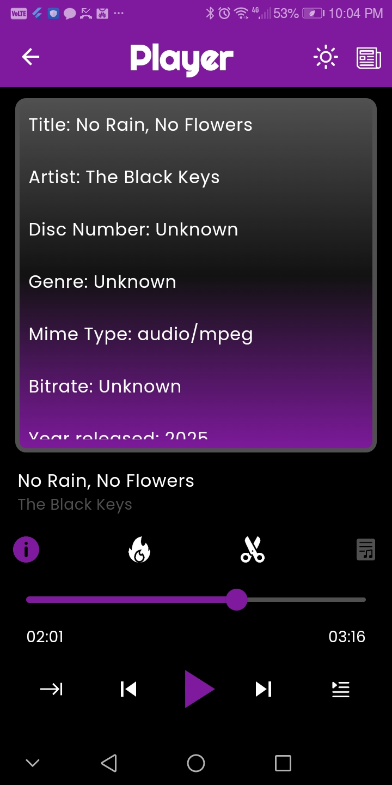
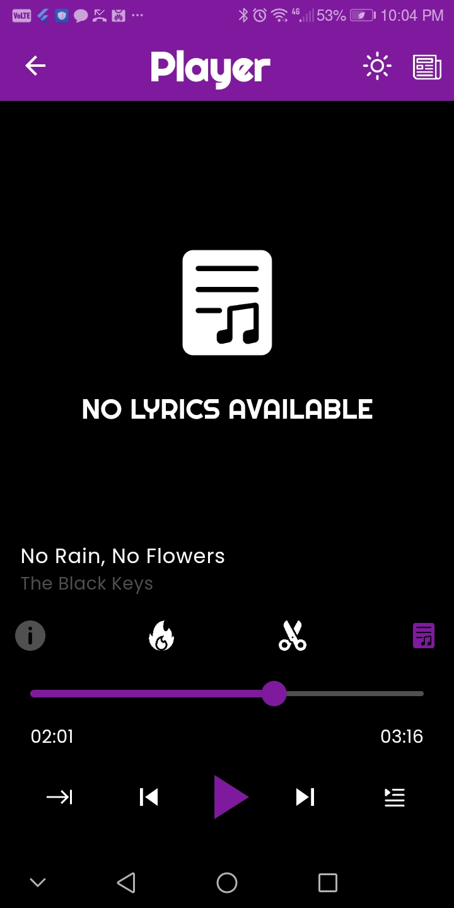
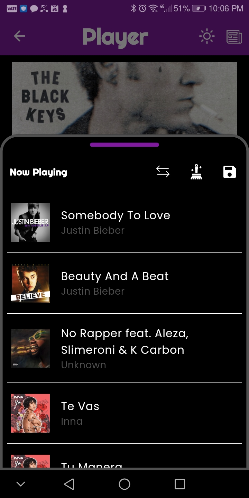
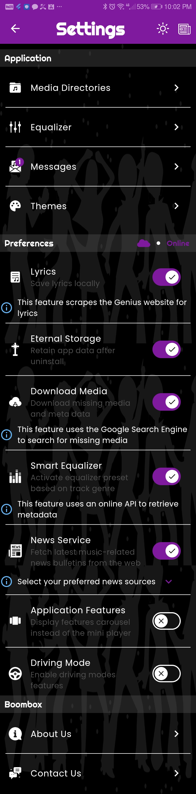

# BoomBox

**The music never stops.**

BoomBox is a Flutter-based local music player for Android, built around playing music you already own rather than streaming it. Point it at the folders where your music lives and it scans, tags, and organizes everything into a proper library — albums, artists, playlists, and a background-capable player with lyrics, an equalizer, and audio trimming.

<p align="center">
  
</p>

## Screenshots

<table>
  <tr>
    <td align="center"><br /><sub>Library</sub></td>
    <td align="center"><br /><sub>Albums</sub></td>
    <td align="center"><br /><sub>Album detail</sub></td>
  </tr>
  <tr>
    <td align="center"><br /><sub>Now playing</sub></td>
    <td align="center"><br /><sub>Track info</sub></td>
    <td align="center"><br /><sub>Lyrics</sub></td>
  </tr>
  <tr>
    <td align="center"><br /><sub>Up next queue</sub></td>
    <td align="center"><br /><sub>Music news</sub></td>
    <td align="center"><br /><sub>Settings</sub></td>
  </tr>
</table>

## Features

- **Folder-based library scanning** — pick one or more directories and BoomBox walks them, pulling tags, artwork, and duration from each file to build your Songs / Albums / Artists library. A sync action re-scans your chosen folders for changes.
- **Full playback controls** — background playback via `audio_service` and `just_audio`, with media-button and notification controls, shuffle, repeat, and a persistent mini-player.
- **Built-in equalizer** — manual band control plus a "Smart Equalizer" that can switch presets automatically based on a track's genre.
- **Lyrics** — fetched on demand and optionally cached locally.
- **Audio trimming** — trim a track's start/end directly from the player.
- **Playlists, Favorites, and Recently Played** — the usual library conveniences, each with their own persisted store.
- **Music news feed** — pulls recent music-industry articles from Billboard.
- **Missing media lookup** — can search for and download missing album art and metadata for tracks that are otherwise unidentified.
- **Configurable storage** — an auto-detect-with-override storage flag chooses between internal storage and an SD card (where available), and an optional "Eternal Storage" mode keeps app data (settings, cached library, logs) outside app-private storage so it survives an uninstall.
- **Themes** — switchable light/dark and custom color themes.
- **Driving mode** — a simplified, less distracting UI mode (in progress).
- **In-app notifications/messages** — surfaces mapping status, download results, and other background activity as dismissible in-app messages.

## Tech stack

- **Flutter** (Dart SDK `^3.7.2`)
- **State management:** `provider` with `ChangeNotifier` singletons per feature, plus a lightweight custom pub/sub `ServiceBus` for cross-service messaging
- **Audio:** `just_audio`, `audio_service`, `audio_session`, `equalizer_flutter`, `audio_decoder`
- **Media/file access:** `flutter_media_metadata`, `file_picker`, `path_provider`, `permission_handler`, `mime`
- **Persistence:** `shared_preferences` plus a custom `FileStorageService` for JSON-backed caches (library, directories, logs) stored either in app-private storage or an "Eternal" external folder
- **Networking/scraping:** `http`, `http_interceptor`, `beautiful_soup_dart` (news and lyrics are fetched by scraping public pages — see note below)
- **Notifications:** `awesome_notifications`
- **UI:** `animated_theme_switcher`, `flex_color_picker`, `carousel_slider`

## Project structure

The app is organized by feature, not by layer. Each top-level folder under `lib/` is a self-contained "component" with its own `models/`, `services/`, and `widgets/`:

```
lib/
├── common/                   # shared services, widgets, theming, logging, HTTP, service bus
├── directory-component/      # folder picking, directory scanning, sync
├── equalizer-component/      # equalizer UI + equalizer_flutter integration
├── favorites-component/      # favorited tracks
├── library-component/        # library landing page, missing-media lookup
├── message-component/        # in-app notification/message center
├── music-component/          # album/song/artist mapping, search, sorting
├── news-component/           # music news feed (Billboard)
├── player-component/         # playback engine, now-playing UI, lyrics, trimming, queue
├── playlist-component/       # playlist CRUD
├── recently-played-component/
├── settings-component/       # app settings and user preferences
└── theme-component/          # theme switching
```

Each service is typically a singleton (`factory` constructor returning a shared instance), registered once at app startup in `main.dart` via a `MultiProvider`.

## Getting started

### Prerequisites

- [Flutter SDK](https://docs.flutter.dev/get-started/install) (Dart `^3.7.2` or later)
- An Android device or emulator (the app currently targets Android; `android:targetSdk` is set in `android/app/build.gradle.kts`)

### Setup

```bash
git clone git@github.com:MASTA-CYA/boombox.ui.git
cd boombox.ui/boombox
flutter pub get
flutter run
```

On first launch, BoomBox will ask for storage permissions, then head to **Settings → Media Directories** to pick the folder(s) where your music lives. From there, the library builds itself.

### Storage permissions

BoomBox scans folders you pick directly via the filesystem rather than through Android's `MediaStore`, so on Android 11+ it requests `MANAGE_EXTERNAL_STORAGE` ("All files access") in addition to the standard media/storage permissions — without it, folder scans can silently return no files. You'll be taken to a system settings screen to grant it; after granting, trigger a folder sync (or relaunch) to pick up your library.

## Status

BoomBox is an actively developed personal project, not a published release — some features (like Driving Mode) are still in progress, and some settings (like the Discogs/Google-powered "Download Media" lookup and the Genius-backed lyrics fetch) depend on external services and are best-effort.
